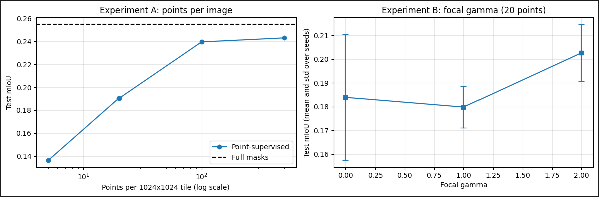
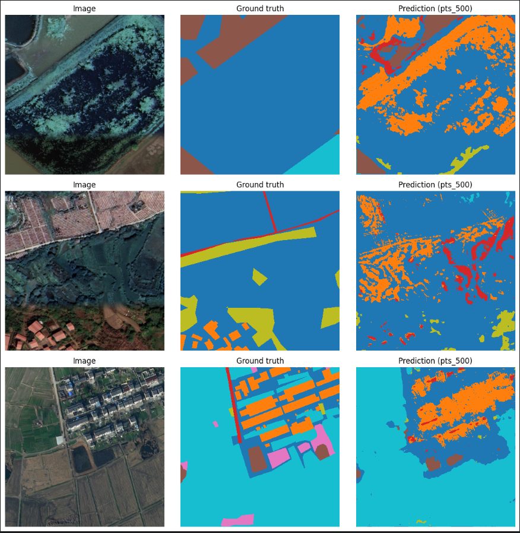

# Point-Supervised Remote Sensing Segmentation with Partial Focal Cross Entropy

Technical report for the assessment task. The code is in two notebooks:

- `Data_check_and_split.ipynb` checks the dataset and writes the train / val / test split files.
- `Point_supervised_segmentation.ipynb` holds the loss, the point label simulation, the model, the training code, both experiments and the results.

## 1. Summary

- A partial focal cross entropy loss was implemented and tested. It computes the focal loss only at labelled pixels and averages over the number of labelled pixels.
- Point labels were simulated on the LoveDA land-cover dataset by keeping a fixed number of randomly chosen pixels per tile, and a U-Net was trained on them.
- **Experiment A (points per tile):** test mIoU rose from 0.136 with 5 points to 0.240 with 100 points, then levelled off (0.243 with 500 points).
- **Experiment B (focal gamma):** no measurable effect. The difference between gamma values was smaller than the difference between two seeds of the same gamma.
- **Main limitation:** the study used a small compute budget (600 training tiles, 8 epochs). The fully supervised reference reached only 0.255 mIoU, so all models are undertrained and the gap between point and full supervision is probably underestimated.
- **Dataset:** LoveDA (`damifinocchiaro/loveda`), A dataset for land use and land cover classification in remote sensing.

## 2. Problem

Semantic segmentation normally needs a complete mask for every training image. In remote sensing this is expensive to produce. Point annotation is much cheaper: the annotator labels a few pixels per image and every other pixel stays unknown.

A standard cross entropy loss cannot be used directly, because most pixels have no target. Treating them as a background class would teach the model something false. The task is to train a segmentation network from point labels only, and to study what affects the result.

## 3. Method

### 3.1 Partial focal cross entropy loss

The loss follows the formula given in the task:

```
pfCE = sum( FocalLoss(pred, GT) * MASK_labeled ) / sum( MASK_labeled )
```

For each pixel, with `p_t` the predicted probability of the true class:

```
CE    = -log(p_t)
Focal = (1 - p_t)^gamma * CE
```

`MASK_labeled` is 1 at labelled pixels and 0 elsewhere. Unlabelled pixels carry the value 255 in the target and contribute neither loss nor gradient. Dividing by the number of labelled pixels keeps the loss on the same scale for any number of points. The denominator is clamped to at least 1, so a batch without any labelled pixel gives 0 and not NaN. With `gamma = 0` the loss is plain partial cross entropy.

The loss is verified by five tests in the notebook:

1. With `gamma = 0` it equals PyTorch's `cross_entropy` with `ignore_index`.
2. Changing the logits at unlabelled pixels does not change the loss.
3. The gradient is exactly zero at unlabelled pixels and non-zero at labelled ones.
4. A target with no labelled pixel gives 0.
5. `gamma = 2` gives a smaller loss than `gamma = 0` on the same input.

### 3.2 Dataset

LoveDA is a land-cover dataset of 1024 x 1024 aerial tiles at 0.3 m resolution, with urban and rural scenes and seven classes. The official Train split has 2,522 tiles and the official Val split 1,669.

To fit the compute budget, a fixed, seeded sample was used. Each sample keeps the urban / rural mix of its source.

| Split | Tiles | Urban | Rural | Source | Use |
|---|---|---|---|---|---|
| Train | 600 | 275 | 325 | Official Train | Training with point labels |
| Val | 200 | 81 | 119 | Official Val | Choosing the checkpoint |
| Test | 400 | 162 | 238 | Official Val, not in val | Reported numbers |

In the masks, value 0 means no data and values 1-7 are the classes. No-data pixels are mapped to 255 (ignored) and the classes to 0-6.

Pixel share per class, estimated on a seeded sample of 300 official Train masks:

| Class | Share |
|---|---|
| No data | 3.44 % |
| Background | 34.70 % |
| Agriculture | 17.93 % |
| Forest | 14.64 % |
| Building | 12.69 % |
| Water | 6.71 % |
| Road | 5.66 % |
| Barren | 4.23 % |

The largest class is about eight times more frequent than the smallest.

### 3.3 Simulating point labels

For each training tile, N pixels are chosen uniformly at random among the valid pixels. They keep their class and every other pixel is set to 255.

The points of a tile are fixed. The random generator is seeded from the run seed and the tile's file name, so a tile has the same points in every epoch. Resampling every epoch would gradually reveal the whole mask and would no longer be point supervision.

N counts points per 1024 x 1024 tile. Training uses random 512 x 512 crops, so one crop contains about a quarter of the tile's points. With 100 points, 0.0095 % of a tile's pixels are labelled.

Validation and test tiles keep their complete masks.

### 3.4 Model and training

| Item | Setting |
|---|---|
| Network | U-Net with a ResNet-34 encoder pretrained on ImageNet (`segmentation_models_pytorch`) |
| Input | Random 512 x 512 crop, random horizontal and vertical flips, ImageNet normalisation |
| Optimiser | AdamW, learning rate 1e-3, batch size 8 |
| Length | 8 epochs (75 steps per epoch, 600 steps per run) |
| Precision | Mixed precision; the loss is computed in full precision |
| Evaluation | Full 1024 x 1024 tiles with complete masks |
| Metric | IoU per class from one confusion matrix over the whole set, and their mean (mIoU) |

After each epoch the model is evaluated on the validation set, and the checkpoint with the best validation mIoU is kept. That checkpoint is then evaluated once on the test set. All numbers in this report are test numbers unless stated otherwise. One run takes about five minutes on a Kaggle GPU.

## 4. Experiment A: number of points per tile

### Purpose

Measure how segmentation quality depends on the number of annotated points per tile, and compare with full-mask supervision.

### Hypothesis

More points per tile improve mIoU with diminishing returns, approaching the full-mask result.

### Process

Five runs that differ only in the labels available for training: 5, 20, 100 and 500 points per tile, and complete masks as the reference. All use `gamma = 2`, uniform sampling and seed 42.

### Results

| Run | Val mIoU | Test mIoU | Background | Building | Road | Water | Barren | Forest | Agriculture |
|---|---|---|---|---|---|---|---|---|---|
| 5 points | 0.137 | 0.136 | 0.364 | 0.168 | 0.030 | 0.000 | 0.000 | 0.136 | 0.255 |
| 20 points | 0.184 | 0.191 | 0.395 | 0.086 | 0.000 | 0.265 | 0.000 | 0.258 | 0.330 |
| 100 points | 0.235 | 0.240 | 0.443 | 0.262 | 0.000 | 0.293 | 0.001 | 0.269 | 0.409 |
| 500 points | 0.241 | 0.243 | 0.342 | 0.174 | 0.142 | 0.359 | 0.000 | 0.267 | 0.419 |
| Full masks | 0.253 | 0.255 | 0.356 | 0.376 | 0.004 | 0.399 | 0.000 | 0.239 | 0.411 |

Per-class columns are test IoU.



### Discussion

- **The trend is as expected for few points.** Test mIoU rises from 0.136 (5 points) to 0.191 (20 points) and 0.240 (100 points). Water is the clearest case: it is not learned at all with 5 points and improves with every step.
- **The gain stops after 100 points.** Five times more labels (500 points) add only 0.003.
- **The full-mask reference is low.** It reaches 0.255, only 0.015 above the 100-point run. Barren has an IoU of zero in every run and road is near zero in all but one, including the full-mask run. With two of seven classes at zero, mIoU cannot rise far above 0.3.
- **Interpretation.** The plateau is set by the training budget and not by the amount of labels. Each run has only 600 optimisation steps, the training loss was still falling in the last epoch, and validation mIoU changed by up to 0.05 from one epoch to the next. The models did not train long enough to use the extra labels or to learn the rare classes.
- **Buildings benefit most from full masks** (0.376 against 0.09-0.26 with points). Buildings are small objects with a lot of boundary, and random points rarely fall on a boundary.

The first part of the hypothesis is supported: more points help, with diminishing returns. The second part is not established. The point-supervised models come close to the full-mask model here, but only because the full-mask model is undertrained.

## 5. Experiment B: focal gamma

### Purpose

Test whether focal weighting (`gamma > 0`) improves point-supervised training over plain partial cross entropy (`gamma = 0`).

### Hypothesis

Moderate focal weighting (`gamma` of 1 or 2) concentrates learning on hard and rare-class points and gives a higher mIoU than `gamma = 0`.

### Process

`gamma` of 0, 1 and 2 at 20 points per tile, each with seeds 42 and 43. The seed changes both the sampled points and the training randomness, so the spread between seeds shows how much of a difference is noise. The run with `gamma = 2` and seed 42 is the 20-point run of Experiment A.

### Results

| Gamma | Seed 42 | Seed 43 | Mean | Std |
|---|---|---|---|---|
| 0.0 | 0.211 | 0.157 | 0.184 | 0.027 |
| 1.0 | 0.189 | 0.171 | 0.180 | 0.009 |
| 2.0 | 0.191 | 0.215 | 0.203 | 0.012 |

Values are test mIoU.

### Discussion

- The means lie within 0.023 of each other (0.180 to 0.203).
- Two runs with the same gamma of 0 differ by 0.053, more than twice that range.
- The order is not stable: `gamma = 0` is the best setting with seed 42 and the worst with seed 43.
- Barren and road stay at zero IoU for every gamma, so focal weighting did not help the rare classes either.

The hypothesis is not supported. In this setup, changing gamma has no measurable effect on test mIoU. `gamma = 2` has the highest mean, but with two seeds and this spread it cannot be told apart from the others. This is a statement about this budget and this point count; the experiment does not show that gamma has no effect in general.

## 6. Qualitative results



Predictions of the 500-point model on three test tiles are fragmented and speckled. Large regions are partly recovered, but building is predicted on textured vegetation and region boundaries do not follow the ground truth. This matches an mIoU of about 0.24.

## 7. Limitations

- **Short training.** 600 tiles and 8 epochs give 600 optimisation steps per run. The fully supervised reference reaches only 0.255 mIoU, far below what this dataset allows, so every model in the study is undertrained.
- **Underestimated gap.** Because the reference is undertrained, the difference between point and full supervision is probably larger than measured here.
- **Few seeds.** Experiment A uses one seed and Experiment B two. Small differences cannot be separated from noise.
- **Unstable validation.** Validation mIoU varied by up to 0.05 between epochs, and the validation set has only 200 tiles, so checkpoint selection is noisy.
- **Rare classes not learned.** Barren and road are at or near zero in every run.
- **Points per tile, not per crop.** A training crop sees about a quarter of the tile's points.

## 8. Further work

With more compute, the next steps would be:

1. Train longer (around 20 epochs or more) with a decaying learning rate, on all 2,522 training tiles.
2. Repeat every setting with at least three seeds and report mean and spread.
3. Repeat the gamma experiment at a point count where the model learns reliably, for example 100 points.
4. Compare uniform point sampling with class-balanced sampling, which is already implemented in the notebook, to give rare classes more labels for the same annotation budget.
5. Use the unlabelled pixels, for example with pseudo-labels or consistency training, as the semi-supervised part of the framework described in the task suggests.

